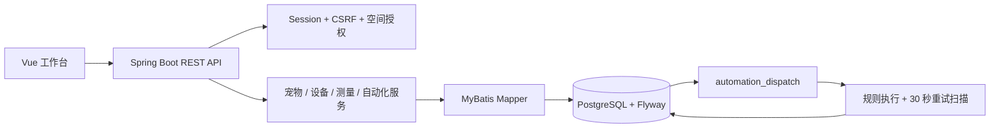

# PetOS 应用设计与接口

## 边界与分层

系统采用单体分层架构，前后端通过 REST/JSON 通信。`frontend` 只负责交互、展示和前端校验；`backend` 以 Controller（请求/校验）、Service（授权/事务/规则）、Mapper（限定工作空间的 SQL）分层；PostgreSQL 负责跨表完整性、时序历史和统计视图。家庭与猫咖不拆产品模块，均以 workspace 作为隔离单元。



密码以 BCrypt 哈希保存，登录状态使用服务端 Session。`GET /api/auth/csrf` 取得 CSRF Token，前端对写请求发送 `X-CSRF-TOKEN`。所有 `/api/workspaces/{workspaceId}/...` 业务端点先校验当前账号的有效 membership；VIEWER 只读，EDITOR/OWNER 可写。当前 UI 只创建 OWNER 账号，角色扩展结构已在库内，但尚无邀请/授权管理界面。

## 关键业务闭环

1. 用户注册产生账号、工作空间和 OWNER membership，事务提交后登录。
2. 设备和宠物归属同一 workspace；专属设备有效期内至多绑定一只宠物，共享设备可以绑定多只。
3. 设备上报携带事件 ID、指标、值和采集时间。数据库验证指标范围、设备能力、区间语义和事件唯一性；原始测量不可修改。专属设备的有效绑定可产生 `BINDING` 归属，共享设备默认 `UNKNOWN`；人工录入须在同一事务附上 `MANUAL` 归属。修订只追加新归属记录。
4. 测量插入触发器同时写入 `automation_dispatch`。提交后规则服务尝试处理；若服务在此时退出，定时扫描会重新读取待处理行。规则匹配、冷却和动作在数据库中二次验证，执行行保存规则快照。单条规则失败不回滚原始测量。
5. 告警可标记已处理；模拟设备命令可以记录 `REQUESTED → APPLIED`，并不调用真实硬件。执行与动作记录通过约束保持对应。
6. SQL 视图提供宠物最近体重、按上海日期聚合的 30 天活动/饮食、设备最新测量。AI 端点不读取模型结果，统一返回明确的 501。

## API 索引

所有路径均以 `/api` 开头；成功返回 JSON 或空响应，失败返回 `{ "message": "..." }`。写请求需 Session Cookie 和 CSRF Header。

| 类别 | 端点 |
|---|---|
| 身份 | `GET /auth/csrf`，`POST /auth/register`，`POST /auth/login`，`GET /auth/me`，`POST /auth/logout` |
| 工作空间 | `GET/POST /workspaces`，`GET/POST /workspaces/{w}/spaces`，`PUT /workspaces/{w}/spaces/{s}` |
| 宠物 | `GET/POST /workspaces/{w}/pets`，`GET/PUT /workspaces/{w}/pets/{p}`，`POST /workspaces/{w}/pets/{p}/retire` |
| 健康 | `GET/POST /workspaces/{w}/pets/{p}/health-records`，`GET /workspaces/{w}/pets/{p}/report` |
| 设备 | `GET/POST /workspaces/{w}/devices`，`GET/PUT /workspaces/{w}/devices/{d}`，`POST /workspaces/{w}/devices/{d}/status` |
| 设备关联/指令 | `GET/POST /workspaces/{w}/devices/{d}/bindings`，`POST /workspaces/{w}/devices/{d}/bindings/{b}/close`，`GET/POST /workspaces/{w}/devices/{d}/commands` |
| 测量 | `GET /metrics`，`GET/POST /workspaces/{w}/measurements`，`POST /workspaces/{w}/measurements/{m}/attributions` |
| 自动化 | `GET/POST /workspaces/{w}/rules`，`POST /workspaces/{w}/rules/{r}/enabled`，`GET /workspaces/{w}/executions`，`GET /workspaces/{w}/alerts`，`POST /workspaces/{w}/alerts/{a}/resolve` |
| AI 占位 | `POST /workspaces/{w}/ai/health-analysis/{p}`、`behavior-recognition/{p}`、`assistant`、`database-query`、`automation-decision`；始终返回 501 |

### 历史数据可视化

宠物、设备列表下方提供历史面板，也可通过每行的“数据趋势”或“历史数据”跳转。支持近 7/30/90 天、自选日期（最多 366 天）、按天/周汇总、指标切换、折线、柱形、记录来源环形图及分页阶段表。

`GET /api/workspaces/{w}/measurements/history?petId={p}&start=2026-11-01&end=2026-11-25`（设备使用 `deviceId`；二者须且只能指定一个）。需登录及空间读取权限。接口按上海日期在数据库聚合完整时段，不使用最近 200 条列表；每天每指标返回条数、均值、最小/最大值、总量和人工/设备条数。结束日期包含当天。宠物统计使用最新归属，设备统计包含尚未识别宠物的记录。

体重等连续读数按阶段均值展示；活动分钟、进食克数、饮水毫升按阶段累计。周从周一开始，均值按原始记录条数加权，仅包含所选日期内的数据。无记录日期不补零。折线纵轴随数据缩放，柱形保留零基线。来源环形图仅比较同一指标的记录条数，不混合不同单位。

前端计算测试：在 `frontend` 下运行 `node src/history.test.js`。

### 示例：设备上报请求体

```json
{
  "sourceKind": "DEVICE",
  "deviceId": 2,
  "spaceId": null,
  "petId": null,
  "sourceEventId": "scale-20261014-001",
  "metricCode": "weight_kg",
  "value": 4.2,
  "periodStartedAt": null,
  "measuredAt": "2026-10-14T12:00:00Z"
}
```

`activity_minutes` 必须提供 `periodStartedAt`；环境指标必须指定与设备一致的区域。重复 `(workspace_id, device_id, source_event_id)` 返回冲突，不会重复触发规则。

### 示例：告警规则

```json
{
  "name": "体重过高提醒",
  "metricCode": "weight_kg",
  "comparator": "GT",
  "threshold": 6.0,
  "sourceDeviceId": null,
  "petId": null,
  "actionKind": "ALERT",
  "targetDeviceId": null,
  "actionPayload": {},
  "severity": "WARNING",
  "cooldownSeconds": 3600
}
```

自动设备动作使用 `actionKind: "DEVICE_COMMAND"`、有效的 `targetDeviceId` 和类似 `{ "command_type": "PING" }` 的 `actionPayload`。只支持模拟 `PING`、`TARE`、`DISPENSE`；`DISPENSE` 还须提供 0–5000 范围的 `amount`。

## 交付边界和后续扩展

- 暂无 MQTT/真实硬件鉴权与回执；当前设备上报通过授权用户操作接口模拟，不能当成生产设备接入网关。
- 自动化为单指标阈值，不实现多信号推理、AI 决策或跨系统消息通知。待处理队列可在进程退出后恢复，但没有多节点分布式调度与历史规则版本回放。
- `v_pet_daily_totals` 使用 Asia/Shanghai 日期；多时区部署需增加 workspace 时区并调整统计逻辑。
- 数据量达到大规模时应以真实 `EXPLAIN ANALYZE` 和负载确定分区、归档与索引，不在课程规模预设复杂运维系统。
