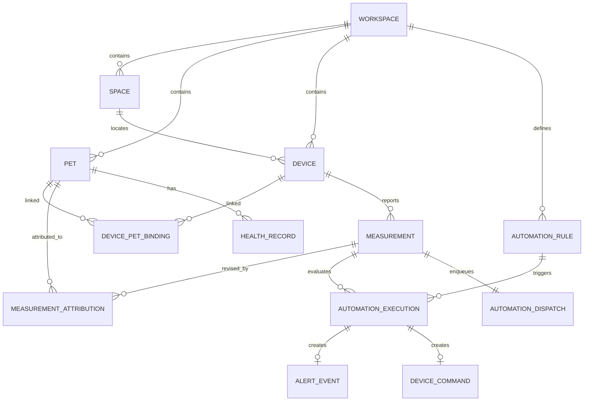

# PetOS 数据库设计基线

## 目标与边界

这一版数据库服务于可运行的前后端分离课程设计。系统按业务对象划分为宠物、设备、空间、测量、自动化，不为家庭和猫咖建两套表。`workspace` 是数据隔离边界，代表一个家庭或一个使用单位；它不承担会员或商业经营含义。

AI 健康分析、行为识别、智能问答和 AI 决策仅在未来应用层预留接口。数据库没有所谓的“AI 诊断结果”演示行。普通统计、阈值规则与设备模拟可独立运行。

## 核心关系

### 数据隔离

所有重要的跨表引用都带 `workspace_id`，用组合外键阻止把 A 空间的宠物、设备或记录错误关联到 B 空间。`user_account` 与 `workspace_membership` 提供最小的账号和空间授权基础，角色只决定权限，不产生不同的产品模块。后端查询仍必须核对当前用户的有效 membership，并将 `workspace_id` 加入所有业务查询；数据库不会从 HTTP 请求自动识别用户。部署时应给应用账号最小表权限，迁移账号单独保管。

### 设备与宠物

设备有 `DEDICATED` 和 `SHARED` 两种共享策略。关联行使用左闭右开的 `[bound_at, unbound_at)` 时间段，避免边界时刻同时属于前后两次绑定。排他约束禁止同一设备与同一宠物的重叠关联，也禁止专属设备在同一时刻关联两只宠物。共享设备允许同时关联多只宠物。

共享设备的关联只说明“可由这些宠物使用”，不证明某条数据属于哪只宠物。没有身份证据时原始测量保持未知。通过有效关联与外部识别手段确认后，追加一条 `IDENTIFIED` 归属记录；专属设备可使用 `BINDING` 归属方法。人工录入使用 `MANUAL` 初始归属；设备数据的人工确认使用 `IDENTIFIED` 修订，旧版本仍在。`v_measurement_current` 取最新修正。

### 时序与指标

`metric_type` 定义指标单位、适用对象、合理值范围及是否需要观测区间；`device_metric_capability` 定义设备种类可上传哪些指标。活动时长必须同时记录区间起点与终点，时长不能大于观测区间。设备上报需要非空 `source_event_id`，同一设备重复上报相同事件被唯一约束拒绝。人工测量须在同一事务内写入宠物归属。原始 `measurement` 禁止更新和删除，确保时间序列可追溯。

当前测量表适合课程设计量级。未来若单日达到百万级记录，再根据真实查询计划考虑按 `measured_at` 分区；现在就分区会使事件唯一约束、外键和维护复杂度增加。

### 自动化

`automation_rule` 保存单指标比较条件、可选的设备和宠物范围、冷却时间以及动作类型。测量写入触发器在同一事务内创建 `automation_dispatch`；提交后服务层处理匹配规则，进程中断后的待处理行由定时扫描恢复。每条规则在独立事务内创建 `automation_execution`，再创建告警或设备指令。数据库触发器检查阈值、筛选条件与冷却时间，并在执行行保存规则快照；`(rule_id, measurement_id)` 唯一约束阻止同一事件重复执行。告警与设备指令各自保留状态。设备指令另有每设备的幂等键。

规则执行触发器锁定规则行以串行化同一规则的检查；服务层预筛冷却并按测量记录时间创建执行记录。模拟设备动作立即标记 `APPLIED`；离线目标则记录 `FAILED`。这里没有真实硬件回执，不把模拟状态描述为现实执行。待处理行在至少一个规则事务失败时保留供重试；若规则已被修改/禁用，重试以当前启用规则为准，这是课程版的明确边界。

## 查询与事务重点

- 使用 `v_pet_latest_weight` 查询宠物最新体重；按时间范围查询历史体重可使用窗口函数计算变化。
- `v_pet_daily_totals` 按上海本地日期统计活动、进食和饮水量。若部署到其他时区，应为 workspace 增加时区字段后改为按该时区汇总。
- 原始测量写入与首次归属判断应同事务提交；归属修正只追加新版本。
- 创建设备绑定前需验证设备和宠物同属 workspace；数据库组合外键与排他约束提供第二道保障。
- 设备命令“请求、执行确认、失败”应有明确状态转换。后端还需检验谁可以发命令、命令类型是否适合设备，数据库不会执行硬件安全判断。

## 当前交付边界

REST API、模拟器、规则求值服务和 Vue 工作台已基于这套模型实现。应用的使用和验证方法见根目录 `README.md`；仍未接入真实硬件或 AI。老师 PPT 原件未同步到仓库，因此具体评分条目不能当成已确认需求。
